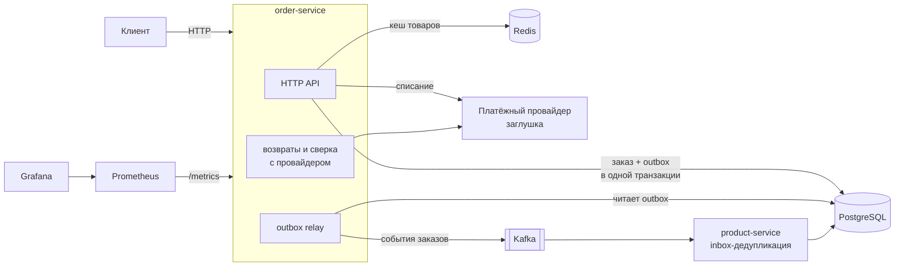

# Order Service: заказы и оплата на Go

[](https://github.com/xdtqwd/microservice-architecture/actions/workflows/ci.yml)


Пет-проект: сервис заказов и оплаты из нескольких микросервисов. Я по очереди
воспроизводил типичные поломки распределённой системы (двойное списание, потерю
событий, долгий простой Kafka, выкатку под нагрузкой) и чинил их с замерами
до и после. Каждый эксперимент описан в `docs/`.

## Что решено

| Проблема | Решение | Результат |
|---|---|---|
| Двойной клик и повтор запроса списывают деньги дважды | Платёж как отдельная сущность, `Idempotency-Key` передаётся до самого провайдера | 2 списания → 1, повтор получает тот же `charge_id` · [разбор](docs/pay01_naive_payment.md) |
| Заказ сохранён, а событие в Kafka не ушло (и наоборот) | Transactional outbox + релей, inbox-дедупликация у потребителя | Рассинхрон воспроизведён и устранён · [разбор](order-service/docs/mq_desync.md) |
| Kafka лежит долго | Экспоненциальный backoff, в DLQ только постоянные ошибки, частичный индекс по очереди | После 30 с простоя 500 событий больше не теряются в DLQ; проход релея на 500 000 строк 27.5 → 0.1 мс · [разбор](docs/fail02_outbox_growth.md) |
| Cache stampede при протухании кеша | singleflight + circuit breaker вокруг Redis | 100 одновременных промахов → 1 запрос в БД · [замер](load-tests/results/cache03_after_singleflight.md) |
| Медленные выборки | Индексы по `EXPLAIN ANALYZE`, keyset-пагинация вместо `OFFSET` | 2391 → 0.09 мс; последняя страница 871 мс → ~0.1 мс · [индексы](load-tests/results/indexes.md), [пагинация](load-tests/results/keyset_pagination.md) |
| Lost update остатков при параллельных заказах | Атомарный `UPDATE` с проверкой остатка, 409 при нехватке | Сравнил три способа починки · [разбор](docs/isolation_levels.md) |
| Запрос висит, пока держится блокировка в БД | Иерархия таймаутов с бюджетом, `DoChan` вместо `Do` у singleflight | Обрыв через 28 с → честный 503 через 3 с · [разбор](docs/timeouts.md) |
| Ошибки при выкатке и выводе узла в k8s | Разделены liveness/readiness, пауза перед остановкой, PodDisruptionBudget | rollout: 5 ошибок из 3000 → 0; drain узла: 64 из 2216 → 0 · [разбор](deploy/k8s/README.md) |

## Архитектура



- **order-service** принимает заказы и оплату и пишет события в outbox в той же
  транзакции, что и заказ. Фоновые воркеры публикуют outbox, делают возвраты,
  находят зависшие платежи и сверяются с провайдером. На нескольких репликах
  воркеры делят строки через `FOR UPDATE SKIP LOCKED`, а сверку берёт на себя
  одна реплика по аренде в базе.
- **product-service** читает события из Kafka. Inbox-таблица защищает от
  повторной обработки, в том числе после рестарта.
- **Наблюдаемость:** метрики Prometheus (запросы, пул соединений, лаг outbox,
  состояние breaker), дашборды Grafana, алерты на лаг outbox и долю 5xx.

## Быстрый старт

Нужен только Docker.

```bash
git clone https://github.com/xdtqwd/microservice-architecture
cd microservice-architecture
git config core.hooksPath .githooks
docker compose up -d
```

| Что | Адрес |
|---|---|
| order-service | http://localhost:8083 |
| product-service | http://localhost:8082 |
| Grafana | http://localhost:3000 |
| Prometheus | http://localhost:9090 |

Создать заказ и оплатить его:

```bash
curl -X POST http://localhost:8083/orders \
  -H "Content-Type: application/json" \
  -H "Idempotency-Key: order-1" \
  -d '[{"product_id": 1, "quantity": 2}]'

curl -X POST http://localhost:8083/orders/<id>/pay \
  -H "Idempotency-Key: pay-1"
```

Повторите оплату с тем же ключом: придёт тот же `charge_id`, второго списания не будет.

Все эндпоинты, схема БД и make-команды описаны в [order-service/README.md](order-service/README.md).

## Kubernetes

Манифесты для локального кластера [kind](https://kind.sigs.k8s.io/) лежат в
[`deploy/k8s/`](deploy/k8s/). Внутри: пробы, миграции отдельным Job, HPA
(3 → 6 реплик за ~20 с под нагрузкой), PodDisruptionBudget, Prometheus в
кластере. Каждый шаг описан в [deploy/k8s/README.md](deploy/k8s/README.md):
что было сломано и как стало.

## Тесты и качество

- Юнит-тесты сервисного слоя и доменной модели, интеграционные тесты
  репозитория на testcontainers (PostgreSQL, Redis), race detector.
- Мутационное тестирование ([gremlins](https://github.com/go-gremlins/gremlins)):
  efficacy сервисного слоя 71% → 86%, найдены и закрыты 3 дыры в тестах.
  [Разбор](docs/mutation_testing.md).
- Нагрузочные тесты на k6: сценарии и результаты лежат в [`load-tests/`](load-tests/).
  Например, `GET /orders` держит 952 rps при p95 = 9.9 мс на 100 VU.
- CI на GitHub Actions: golangci-lint, тесты, race, покрытие, govulncheck,
  сборка Docker-образа. Pre-push хук запускает lint и тесты локально.

## Стек

Go · PostgreSQL (pgx, goose) · Redis · Kafka (kafka-go) · Docker Compose ·
Kubernetes (kind) · Prometheus · Grafana · k6 · zap · GitHub Actions

## Структура

```
order-service/     основной сервис: HTTP API, платежи, outbox, воркеры
product-service/   потребитель событий Kafka с inbox
user-service/      заготовка регистрации и JWT, пока не подключён
deploy/k8s/        манифесты и эксперименты в Kubernetes
load-tests/        сценарии k6 и результаты замеров
docs/              разборы экспериментов
```
